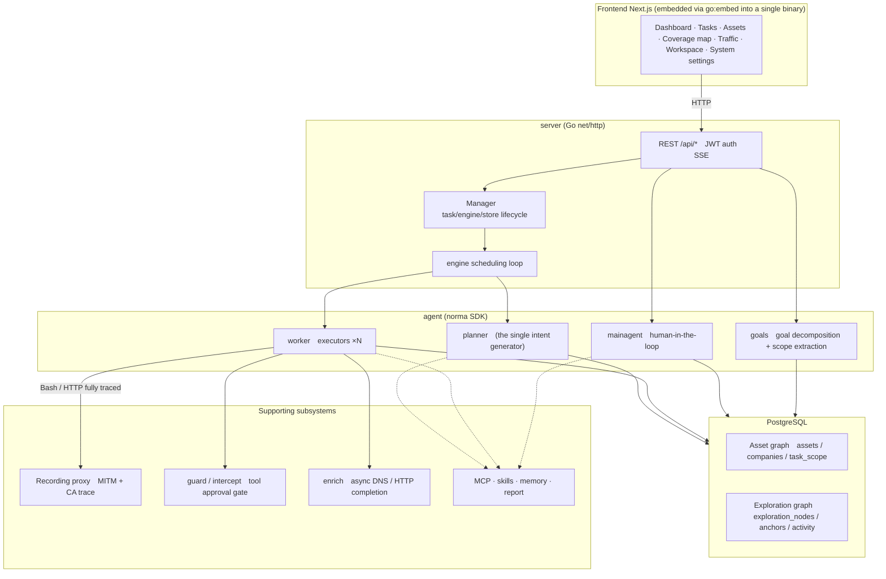
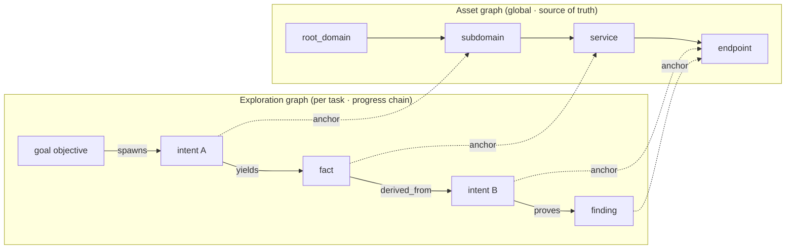
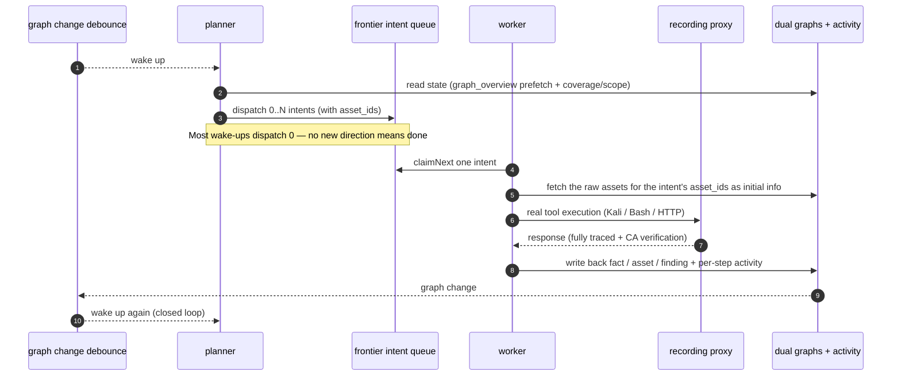
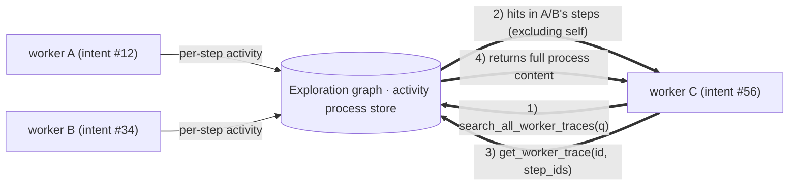
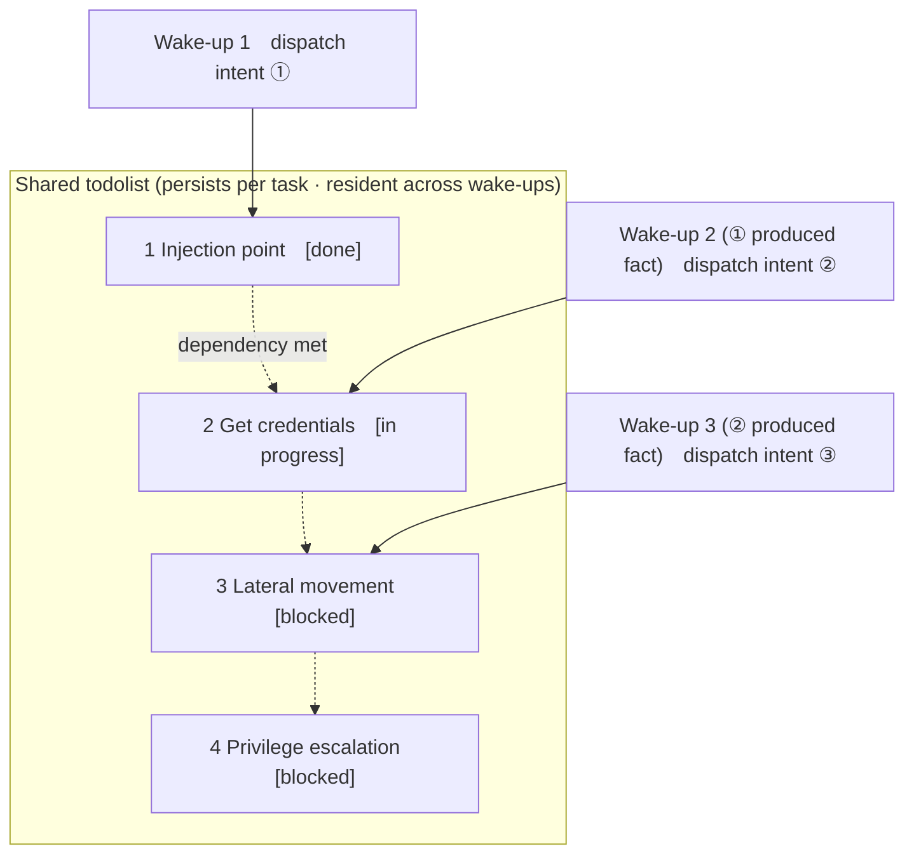

<div align="center">

# ARTEX Fork — Windsurf/Devin SWE-2 Integration

Fork of [ARTEX](https://github.com/konanguyen/ARTEX) with native **Devin SWE-2 model support** via reverse-engineered Codeium Connect protocol.

</div>

## What This Fork Adds

- **Windsurf LLM provider** (`norma/llm/windsurf/windsurf.go`) — direct protobuf-over-HTTP to `server.codeium.com`, bypassing the Devin agent harness. ARTEX's agent loop keeps full control over tool calling, message history, and system prompts.
- **SWE-2 models** — `swe-2-high`, `swe-2-medium`, `swe-2-max` as selectable LLM profiles.
- **CloakBrowser** — stealth Chromium with 87 C++ patches for evading bot detection.
- **Traffic capture fixes** — mitmproxy-based evidence collection for vulnerability findings.
- **Protocol docs** — full reverse-engineering writeup at [`docs/windsurf-integration.md`](docs/windsurf-integration.md), reusable for connecting SWE-2 to any tool.

## Fork Quick Start

### Prerequisites

- Docker and Docker Compose v2
- [Devin Pro](https://devin.ai) subscription (for SWE-2 — optional if using OpenAI/Anthropic)

### Setup

```bash
git clone https://github.com/HuuDoe/artex-fork.git
cd artex-fork

# Create .env (only POSTGRES_PASSWORD is required)
cat > .env <<'EOF'
POSTGRES_PASSWORD=artex-local-2026
EOF

# (Optional) Install Devin CLI and authenticate for SWE-2 support
curl -fsSL https://cli.devin.ai/install.sh | bash
devin auth login    # opens browser for Devin Pro auth

# Build and start
docker compose build    # ~6 min first time
docker compose up -d
```

Or use the automated script: `./setup.sh` (handles all of the above interactively).

**Web UI:** http://localhost:8787 — login with `ARTEX` / `ARTEX`

### Adding SWE-2 as an LLM Profile

1. Go to **System → LLM Profiles** → **Add Profile**
2. Set **Provider** to `windsurf`
3. Set **Model** to `swe-2-high` (or `swe-2-medium` / `swe-2-max`)
4. Leave **API Key** empty — it reads from your Devin credentials automatically
5. Click **Test**, then **Save**

The Windsurf provider reads `windsurf_api_key` from `~/.local/share/devin/credentials.toml` on your host, which is mounted read-only into the container by `docker-compose.yml`.

### Using Without SWE-2

Skip the Devin CLI step. Configure OpenAI or Anthropic profiles instead:

1. Add your API key to `.env` (`OPENAI_API_KEY=sk-...` or `ANTHROPIC_API_KEY=sk-...`)
2. Or add profiles through the web UI under **System → LLM Profiles**

### How the Windsurf Integration Works

```
ARTEX agent loop  →  Windsurf provider (Go)  →  server.codeium.com
                     hand-rolled protobuf         GetChatMessage (streaming)
                     windsurf-api-key header       returns deltas + tool calls
```

No `.proto` files — all protobuf encoding is hand-rolled (~70 lines). No Devin harness in the loop. Full protocol specification: [`docs/windsurf-integration.md`](docs/windsurf-integration.md).

### Docker Compose Override (Optional)

The base `docker-compose.yml` handles everything including Devin credential mounts. A `docker-compose.override.yml` is only needed if your Devin CLI is at a non-standard path or you need to run the `devin` binary inside the container:

```bash
cp docker-compose.override.yml.example docker-compose.override.yml
# Edit DEVIN_CLI_BIN / DEVIN_DATA_DIR paths if needed
```

---

<details>
<summary><strong>Upstream ARTEX Documentation</strong></summary>

<div align="center">

# ARTEX

Autonomous AI Penetration Testing System (Go backend + Next.js frontend)

English | [简体中文](README_CN.md) | [Tiếng Việt](README_VI.md)

📦 **This repository is the final pure-source backup of ARTEX. The original Docker image `autumn27/artex` is gone; images are now self-maintained by this repository as `mianhuatang11/artex` (Docker Hub). If the pull fails, run `docker compose build` to build locally from pure source — no external prebuilt dependencies.**

</div>

---

## Screenshots

> For the full interactive experience see the [online Demo](https://artex-demo.mhtsec.com) (pure frontend + mock data, no backend required).

| Dashboard (overview / token consumption / activity stream) | Task list |
| :---: | :---: |
|  |  |

| Task · execution trace (sessions / tool calls) | Exploration graph |
| :---: | :---: |
|  |  |

| Findings | Assets |
| :---: | :---: |
|  |  |

| Asset coverage map (force-directed layout · tested highlighted · collapsible nodes) |
| :---: |
|  |

| Traffic recording | Human-in-the-loop chat |
| :---: | :---: |
|  |  |

| Agent management | LLM configuration |
| :---: | :---: |
|  |  |

| Intercept approval | Backend logs |
| :---: | :---: |
|  |  |


---

## Approval record details

The global **Approval Records** page, the per-task **Intercept Approval** tab, and approval cards in chat all support expanding to view details. The layout follows the approval detail component of
[AegisHook](https://github.com/RuoJi6/AegisHook/blob/main/web/src/components/CallDetail.vue), reusing ARTEX's own components and theme:


## Asset sync (ScopeSentry)

Asset data can be synced directly from [ScopeSentry](https://github.com/Autumn-27/ScopeSentry), avoiding duplicate collection:

- On the **Asset Sync** page, enter the ScopeSentry address and API Key to connect the data source;
- Select targets and asset types (domain / subdomain / IP / port / site / endpoint…) by **project** or **task** dimension;
- Import in one click and merge by company asset scope, ready for agents to explore in ARTEX's asset graph.

---

## Installation

> Requires **PostgreSQL**; exploration requires an **LLM** (`ANTHROPIC_API_KEY` or `OPENAI_API_KEY`, or configure it in the UI).

### Option 1: One-click install script (recommended)

```bash
git clone https://github.com/mhtsec/ARTEX.git
cd ARTEX
./install.sh
```

The script detects / auto-installs Docker, then lets you pick **① all in Docker** or **② run locally**:

- **① All in Docker**: enter a Postgres password (press Enter for a random one) → it writes `.env` → `docker compose up -d`.
- **② Local run**: choose a database (connect to an existing one / spin one up with Docker) → generate `config.json` → build an embedded single Go binary → start.

After installation open **http://localhost:8787** (first visit to `/setup` sets the admin password).

### Option 2: Docker Compose (manual)

```bash
git clone https://github.com/mhtsec/ARTEX.git
cd ARTEX
cp .env.example .env          # set POSTGRES_PASSWORD, optionally ANTHROPIC_API_KEY
docker compose up -d          # pulls the mianhuatang11/artex image + postgres
# → http://localhost:8787
```

> The original image `autumn27/artex` has been removed from Docker Hub; images are now self-maintained by this repository as **`mianhuatang11/artex`**.
> If the registry is unavailable (or you want to modify the code), just build locally from pure source: `docker compose build && docker compose up -d`.
> The Dockerfile is a multi-stage build (frontend static export → Go static build → runtime image) and defaults to China-friendly dependency mirrors; add `--build-arg GOPROXY=... / --build-arg NPM_REGISTRY=...` to override.

The image already includes common tools (ripgrep/curl/vim/npm/nmap…); `./skills` and `./data` are bind-mounted for persistence.

Remote MCP in system settings supports `http` (Streamable HTTP) or `sse` (legacy SSE).
Legacy SSE servers usually establish an event stream with `GET /sse`, then receive JSON-RPC requests via the `/message?sessionId=...` URL returned by the service; set the URL to `/sse` and fill the request header as
`Authorization=Bearer <token>`.

### Option 3: Download prebuilt binaries (Releases)

Download the zip for your platform from the original repository's [Releases](https://github.com/Autumn-27/ARTEX/releases) (**this backup repository does not host binaries**; if the original Releases are also gone use Option 2 or 4). After extraction you get `artex` + `start.sh` (`start.bat` on Windows) + `skills/` + `config.example.json`:

```bash
cp config.example.json config.json   # fill in the database connection
./start.sh                           # → http://localhost:8787
```

> Use `start.sh` / `start.bat` to launch instead of running `./artex` directly. It is a supervisor script: after the program exits it decides based on the exit code whether to relaunch, and the in-page
>[one-click update](#option-1-one-click-update-from-the-ui-recommended) relies on it to swap the binary. If you run `./artex` directly it won't be restarted after an update.
> Run in the background: `nohup ./start.sh >artex.log 2>&1 &`.

### Option 4: Build a single binary from source

```bash
# 1) Static export of the frontend
cd web && npm ci && npm run build:static && cd ..
# 2) Copy into the embed directory
cp -r web/out server/webui/dist
# 3) Build (-tags embedui embeds the frontend)
CGO_ENABLED=0 go build -tags embedui -o artex ./cmd/artex
./start.sh
```

### Option 5: Build cross-platform release archives

`build.sh` builds and embeds the frontend, strips debug info using the Go linker, and zips the release files. In release mode it generates zips for Linux amd64/arm64, macOS amd64/arm64 and Windows amd64 by default:

```bash
./build.sh --release
# artifacts: dist/artex-0.3.3-*.zip
```

UPX-packed self-extracting binaries may be incompatible with some Linux kernels, virtualized environments or security policies, so they are disabled by default. Use `ARTEX_TARGETS` to customize targets; if you have confirmed the target environment is compatible you can pass `--upx` explicitly for a smaller binary:

```bash
ARTEX_TARGETS=linux/amd64,windows/amd64 ./build.sh --release
./build.sh --target linux/amd64 --upx
```

---

## Updating

> An upgrade replaces the program only, not the data: the Postgres volume `pgdata`, `./data` (jwt.key / SQLite, etc.) and `./skills` are all preserved. **No manual database migration is needed** — `artex` idempotently re-runs `schema.sql` (including `ADD COLUMN` / `CREATE INDEX IF NOT EXISTS`) on every startup, i.e. "restart = migrate". Back up `./data` and the database before upgrading anyway.

### Option 1: One-click update from the UI (recommended)

In the **System Configuration** page (sidebar "System Configuration" → `/system/settings`), the **Version & Update** card can check for and install new versions without logging into the server.

Click "Update" and ARTEX downloads the release package for the current platform → verifies it against the Release's `SHA256SUMS` → smoke-tests the new binary with `-h` → stages it as `artex.new` → the program exits and `start.sh` / `start.bat` relaunches it to complete the swap. The page waits for the new version to come up and then refreshes.

- **A failure never leaves a broken program behind**: if verification or the smoke test fails, the staged file is discarded and the current version keeps running; if the swapped-in version fails to start 3 times in a row it automatically rolls back to `artex.old` (the failed binary is kept as `artex.failed` for troubleshooting).
- **Roll back any time**: the previous version is kept as `artex.old`, and the card has a "Roll back to previous version" button. Note that database schema changes are not reverted.
- **Updates interrupt running tasks** — an update is a restart, so run it when idle.
- **Development builds get no updates**: this is disabled when the version is `dev` or `git describe` output has a suffix, so release builds cannot overwrite a locally debugged binary.
- **Under Docker only the program is replaced, not the image**: tools like playwright / nmap inside the image are not upgraded, and rebuilding the container with `docker compose up -d` falls back to the version baked into the image. To upgrade the image too, use `docker compose pull artex && docker compose up -d artex`.
- If access to GitHub requires a proxy, configure a **global proxy** on the same page and the update chain will use it. Updates only download from GitHub domains and force HTTPS.

### Option 2: One-click update script

```bash
cd ARTEX
./update.sh
```

The script optionally runs `git pull` first, then lets you choose **① Docker update** or **② local build update** (mirroring `install.sh`):

- **① Docker**: optionally specify the target image tag (press Enter to keep `.env`'s `ARTEX_TAG`, default `latest`) → `docker compose pull` → `docker compose up -d` (restarting with the new image migrates the schema automatically).
- **② Local**: rebuild the frontend static output → recompile `./artex` (takes effect after a restart).

### Option 3: Docker Compose (manual)

```bash
cd ARTEX
git pull                       # update compose / scripts (optional)
# pin a version: set ARTEX_TAG=v0.2.0 in .env; latest is used if unset
docker compose pull artex
docker compose up -d artex     # restart with the new image → auto-migrate schema
docker image prune -f          # clean up old images (optional)
```

### Option 4: Prebuilt binaries (Releases)

Download the new version's zip from [Releases](https://github.com/Autumn-27/ARTEX/releases), stop the old process, overwrite `artex` and `skills/` (keep your `config.json` and `data/`), then restart:

```bash
cp -r <extracted>/skills ./ && cp <extracted>/artex ./
./start.sh
```

### Option 5: Build from source

```bash
git pull
cd web && npm ci && npm run build:static && cd ..
cp -r web/out server/webui/dist
CGO_ENABLED=0 go build -tags embedui -o artex ./cmd/artex
# restart ./start.sh
```

---

## Configuration

**Database** (`config.json`, or override with the `ARTEX_PG_DSN` environment variable):

```json
{
  "database": {
    "host": "127.0.0.1", "port": 5432,
    "user": "artex", "password": "yourpass",
    "dbname": "artex", "sslmode": "disable"
  }
}
```

**LLM**: `export ANTHROPIC_API_KEY=sk-...` (or `OPENAI_API_KEY`); it can also be filled in on the "LLM Configuration" page in the UI.
Optional: `ARTEX_LLM_PROVIDER` / `ARTEX_LLM_MODEL` / `ARTEX_LLM_BASE_URL` / `ARTEX_LLM_PROXY`.

**Concurrency**: the number of work agents per task is configured in "System Settings" (default 3).

**Common flags**: `./start.sh -addr :8787 -proxy :8788` (`-addr` serves the frontend + API, `-proxy` is the traffic recording proxy). The start script passes flags through to `artex` verbatim.

### Reverse proxy deployment (HTTPS / only 443 exposed)

The frontend and the API/SSE are both served by the same backend port (default `:8787`), and the live activity stream uses **same-origin** URLs by default, so there is **no need to set `NEXT_PUBLIC_SSE_BASE`** — you can expose only 443 publicly and keep 8787 on the internal network.

SSE is a long-lived connection with continuous pushes, so the reverse proxy **must disable buffering**, otherwise the browser connects but never receives events (the activity stream just spins forever). Nginx example:

```nginx
server {
    listen 443 ssl;
    server_name your.domain.com;
    # ssl_certificate / ssl_certificate_key ...

    location / {
        proxy_pass http://127.0.0.1:8787;
        proxy_set_header Host $host;
        proxy_set_header X-Forwarded-Proto $scheme;

        # Key SSE settings: no buffering, long timeout, HTTP/1.1
        proxy_buffering off;
        proxy_cache off;
        proxy_read_timeout 3600s;
        proxy_http_version 1.1;
        proxy_set_header Connection "";
    }
}
```

> Only set `NEXT_PUBLIC_SSE_BASE` **at build time** when SSE must use a different origin from the page (e.g. a separate subdomain); that variable is baked into the static bundle by `next build`, so setting it at container runtime has no effect.

---


## Development

### Manual vulnerability retest

The "Retest" tab on a task detail page lets you paginate through the task's vulnerabilities, review past verdicts and evidence, and start a retest manually. After starting it the current tab is kept, showing a spinner and "Retesting"; once the fix is confirmed the vulnerability status is updated accordingly.

Click "Retest" in the action area of each row of the vulnerability list, or click "Start retest" in the "Vulnerability Retest" area of the vulnerability detail, then fill in the optional fixed version, test conditions or limitations. The system creates an independent retest agent session and keeps the current page on start. Flat list, per-task grouping and asset views all expose this entry point; while a retest is running a spinner and "Retesting" are shown, and clicking through lets you open the corresponding session, with the label returning to "Retest" afterwards. Retesting does not require restarting the original scanning task; verdicts are "Still reproducible", "Fixed" or "Unable to confirm", and each round's verdict, evidence and session link are stored in the vulnerability detail.

On first startup the new backend seeds an editable "Vulnerability Retest" (`retester`) agent; its prompt, LLM, run budget and tools can be configured in Agent management. It uses its bound LLM by default, falling back to the global active configuration. When a retest session completes successfully with the verdict "Fixed", the system automatically sets the vulnerability's remediation status to "Fixed"; while running, on failure, on stop, or with any other verdict the original status is kept. Original evidence and reports are always preserved. You can also set "Fixed" manually from the status dropdown. If the same vulnerability is already being retested the existing session is reused, and after a stop, failure or service restart a new retest can be started.

In this version the history is viewed through vulnerability details and sessions; it is not yet included in vulnerability report exports or task archives, and is not automatically linked to traffic captures. Demo mode only generates clearly labeled mock records and never touches real targets.

### Local development and testing

```bash
./dev.sh    # backend(:8787) + traffic proxy(:8788) + frontend next dev(:5173) → http://localhost:5173
```

- Backend: `go run ./cmd/artex` (without `-tags embedui` the frontend is not embedded)
- Frontend: `cd web && npm run dev` (`/api` is proxied to the backend, with hot reload)
- Tests: `go test ./...`
- Mock preview (no backend): `cd web && NEXT_PUBLIC_MOCK=1 npm run dev`
- Redeploying the online demo (Cloudflare Pages, static export + mock data):
  ```bash
  cd web && NEXT_PUBLIC_MOCK=1 npm run build:static
  CLOUDFLARE_API_TOKEN=<token> npx wrangler pages deploy out --project-name=artex-demo --branch=main
  ```

---

## System architecture

ARTEX is an **LLM multi-agent autonomous penetration testing system**: a monolithic Go backend (with the Next.js frontend embedded) + PostgreSQL, where agent capabilities come from the [`norma`](https://github.com/Autumn-27/norma) SDK (`agentcore` / `tool` / `permission` / `harness` / `memory` / `transcript`). At its core is a **dual-graph architecture**, plus two autonomy mechanisms built around it: **process-level information exchange between workers** and a **planner multi-round shared todolist that stabilizes attack chains**.

### Overall layering



| Layer | Responsibility |
| --- | --- |
| **Frontend** | Next.js static export, embedded into a single binary with `go:embed`; visualizes tasks/assets/exploration chains/coverage, human-in-the-loop chat |
| **server** | `net/http` routing + JWT auth + SSE; `Manager` owns the lifecycle of tasks, engines and DB stores |
| **engine** | One `plannerLoop` + N worker goroutines per task; intent claiming, timeout/pause/drain |
| **agent** | goals / planner / worker / mainagent, with `ToolSet` exposing the dual graphs as LLM tools |
| **db** | Dual graphs persisted in Postgres (pgx); schema idempotently created on every startup via `go:embed` |
| **Supporting** | Recording MITM proxy, approval gate, async enrichment, MCP/skills/memory/report |

### Dual-graph architecture: exploration graph + asset graph

The system splits "**what the target is**" and "**how far testing has gone**" into two mutually independent graphs connected by anchors:

- **Asset graph (global, shared)**: a single source of truth for assets across tasks. Nodes are `root_domain / subdomain / ip / service / app / endpoint` and belong to a company; parent-child relations and dedup keys from domain → subdomain → service → endpoint are all computed by the program, and agents only submit raw information.
- **Exploration graph (per task)**: the "thinking and progress" of a single task. Nodes are `goal / intent / fact / finding / hint`, connected by edges such as `spawns / derived_from / yields / proves` into **blood-lineage chains**, answering "which direction was derived from which facts, and what did it produce".
- **The two graphs are linked by anchors**: `exploration_anchors(node_id, asset_id)` anchors intents/facts/findings to concrete assets — so you can go from an "exploration direction" to the assets it targets, and from "a given asset" back to which intents tested it in this task and which facts came out. This also powers **asset test coverage** and the **asset coverage map** (in-scope assets with tested ones highlighted).



> Division of labour: the **planner** reads the exploration graph's state, judges objectives, and only dispatches **intents** into the frontier when there is an uncovered direction; a **worker** claims **one intent**, executes it with real tools, writes new assets/facts/findings back to both graphs and stops. The asset graph is shared fact; the exploration graph is each task's progress chain.

### Engine and intent lifecycle (the closed loop of one exploration)

The engine is an **event-driven** closed loop: any graph change wakes the planner, the planner dispatches intents, a worker claims an intent, executes it and writes back, and the write-back triggers the next round — until the goal is proven (`prove_goal`).



### Process-level information exchange between workers

During a deep exploration many valuable observations (an error, a response body, a hidden parameter) appear in one worker's **execution process** without necessarily being written as a formal fact. To avoid duplicated work and let workers on the chain stand on each other's shoulders, workers can **retrieve processes across works**:

- `search_all_worker_traces(q)`: keyword search across the **execution processes of other works in this task** (automatically excludes the steps of its own intent); hits carry `intent_id`;
- `list_worker_traces` / `get_worker_trace(intent_id, step_ids=[…])`: first see which works have run, then fetch the full content of specific steps of a work for detailed exchange.

So even when the exploration graph has no corresponding fact yet, later workers can reuse observations from others' processes — **information flows between workers at the granularity of "execution process"**, while the boundary stays unchanged (each worker still only does the intent it claimed).



### Planner multi-round shared todolist → stable attack chains

Real attack chains are usually **multi-step sequences with dependencies** (e.g. find an injection point → obtain credentials → lateral movement → privilege escalation); dispatching all of them in parallel at once just falls apart. The planner therefore holds a **planning todolist that persists per task and is shared across wake-ups**:

- the planner is event-driven — it is woken whenever the graph changes, but **each wake-up is a brand-new session**; the shared todolist lets it record a serial exploitation chain **once**, then across subsequent rounds **dispatch intents step by step in dependency order** instead of expanding the entire chain in a single round;
- each round only dispatches intents for the next step whose **predecessor is done and whose required facts already exist**, updating the list as it goes (marking steps already satisfied by facts as complete).



So attack chains still **advance stably, without duplication or misordering** in an "event-driven + stateless session" environment — this is the key to ARTEX autonomously completing multi-step exploitation chains.

---

## Community

Scan the QR code and follow the WeChat official account **SecSentry**; send a private message in the backend to join the discussion group.

<div align="center">


</div>

---
## References

https://github.com/oritera/Cairn


## License and disclaimer

### Open source license

This project is licensed under the **GNU Affero General Public License v3.0 (AGPL-3.0)**; see the [LICENSE](LICENSE) file in the repository root for the full terms.

Anyone is free to use, modify and redistribute this project, but **derivative works must also be open sourced under AGPL-3.0**; in particular, **if you modify this project and provide it to users over a network (e.g. deploying it as an online service), you must make the corresponding complete source code available to those users**.

> ⚠️ **Important**: the open source license itself does not restrict what the software is used for. The "Usage restrictions" and "Disclaimer" below are additional agreements and a solemn statement by the author, and must be respected.

**ARTEX is for personal study, code research and local technical verification only, and must not be used to perform actual testing against any online system or website.**

### Permitted use

- Only for **reading, studying and researching this project's source code**, and for verifying technical principles in a **local isolated environment**;
- Applicable to non-attack purposes such as personal study, academic research and code review.

### Prohibited

- **Strictly forbidden to use this tool to scan, probe, exploit or attack any website, online service or networked system** (regardless of authorization or whether the assets are yours);
- Strictly forbidden to use this tool for any actual penetration test, offensive/defensive confrontation or production environment;
- Strictly forbidden to use this tool for illegal intrusion, data theft, ransomware, denial of service or any destructive or criminal activity;
- Strictly forbidden to use this tool in ways that violate the laws and regulations of your country/region.

### Compliance responsibility

Users must themselves comply with all laws and regulations on cybersecurity, data protection and computer crime in their country/region (in mainland China this includes but is not limited to the Cybersecurity Law, the Data Security Law, the Personal Information Protection Law and related judicial interpretations). **All legal responsibilities and consequences arising from the use of this tool shall be borne by the user.**

### Disclaimer

This project is provided "AS IS", without warranty of any kind, express or implied. The authors and contributors are not liable for any direct or indirect loss, data loss, system damage or legal dispute caused by the use of this tool (regardless of whether the use is proper). **Downloading, installing or using this project means you have read, understood and agreed to all of the above terms.**

</details>
