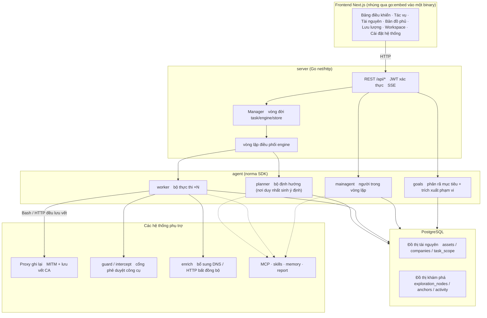
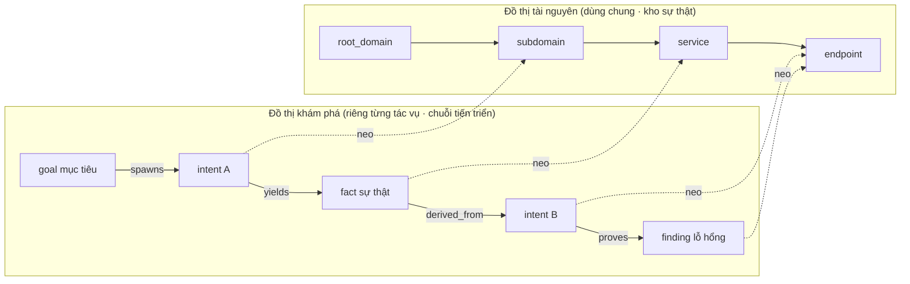
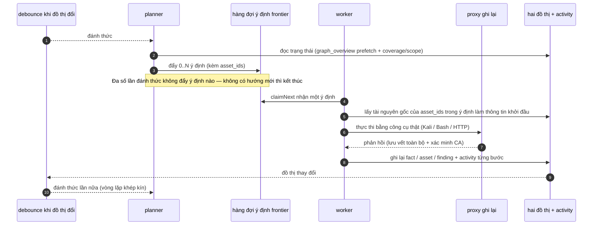
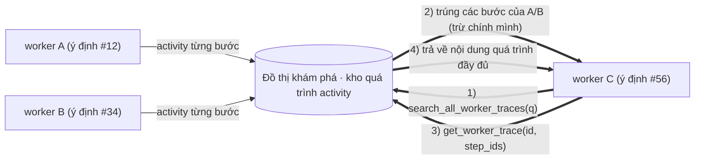
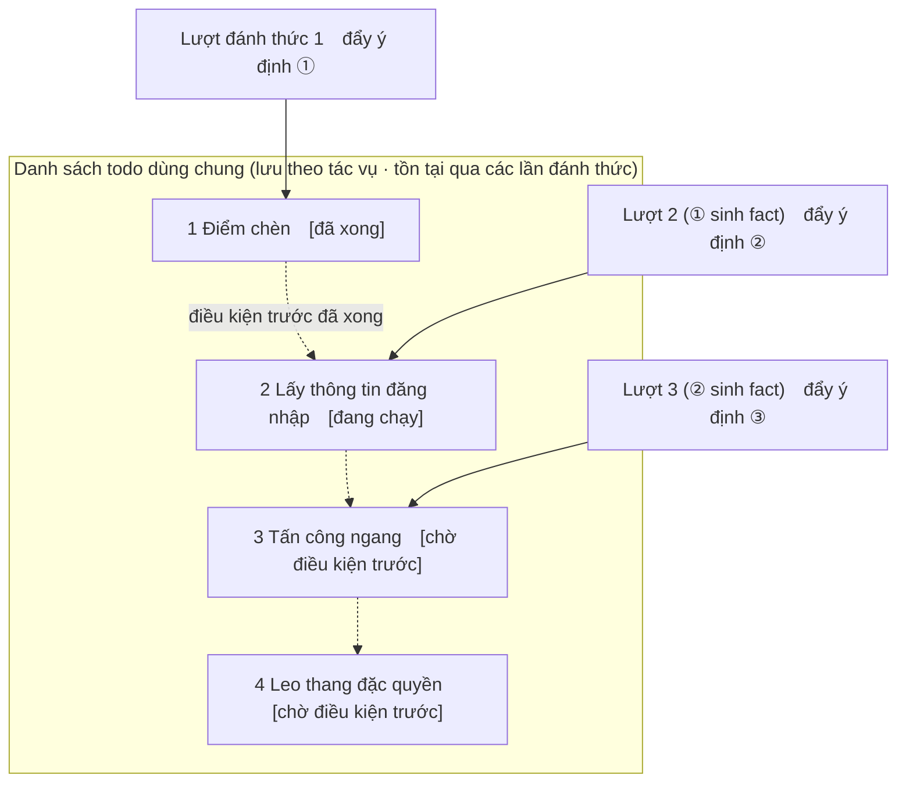

<div align="center">

# ARTEX

Hệ thống Kiểm thử Thâm Nhập Tự Động bằng AI (Backend Go + Frontend Next.js)

[English](README.md) | [简体中文](README_CN.md) | **Tiếng Việt**

🌐 **Demo trực tuyến (dữ liệu mô phỏng)**: [https://artex-demo.mhtsec.com](https://artex-demo.mhtsec.com)

📦 **Kho lưu trữ này là bản sao lưu mã nguồn thuần cuối cùng của ARTEX. Docker image gốc `autumn27/artex` đã không còn; hiện image do chính kho lưu trữ này duy trì với tên `mianhuatang11/artex` (Docker Hub). Nếu kéo image thất bại, hãy chạy `docker compose build` để build cục bộ từ mã nguồn thuần — không phụ thuộc vào bản build sẵn có bên ngoài.**

</div>

---

## Ảnh chụp màn hình

> Để xem trải nghiệm tương tác đầy đủ, hãy xem [Demo trực tuyến](https://artex-demo.mhtsec.com) (thuần frontend + dữ liệu mock, không cần backend).

| Bảng điều khiển (tổng quan / tiêu thụ token / luồng hoạt động) | Danh sách tác vụ |
| :---: | :---: |
|  |  |

| Tác vụ · quá trình thực thi (phiên làm việc / lời gọi công cụ) | Đồ thị khám phá |
| :---: | :---: |
|  |  |

| Phát hiện | Tài nguyên |
| :---: | :---: |
|  |  |

| Bản đồ phủ mức độ kiểm thử tài nguyên (bố cục lực hướng tâm · đã kiểm thử được tô sáng · nút có thể thu gọn/mở rộng) |
| :---: |
|  |

| Ghi lại lưu lượng | Trò chuyện người trong vòng lặp |
| :---: | :---: |
|  |  |

| Quản lý Agent | Cấu hình LLM |
| :---: | :---: |
|  |  |

| Phê duyệt chặn | Nhật ký backend |
| :---: | :---: |
|  |  |


---

## Chi tiết bản ghi phê duyệt

Trang **Lịch sử phê duyệt** toàn cục, tab **Phê duyệt chặn** trong từng tác vụ và các thẻ phê duyệt trong khung trò chuyện đều hỗ trợ mở rộng để xem chi tiết. Cách bố trí tham khảo từ thành phần chi tiết phê duyệt của
[AegisHook](https://github.com/RuoJi6/AegisHook/blob/main/web/src/components/CallDetail.vue), vẫn sử dụng thành phần và giao diện riêng của ARTEX:


## Đồng bộ tài nguyên (ScopeSentry)

Dữ liệu tài nguyên có thể được đồng bộ trực tiếp từ [ScopeSentry](https://github.com/Autumn-27/ScopeSentry), giúp bạn không phải thu thập trùng lặp:

- Tại trang **Đồng bộ tài nguyên**, nhập địa chỉ và API Key của ScopeSentry để kết nối nguồn dữ liệu;
- Chọn mục tiêu và loại tài nguyên (tên miền / tên miền phụ / IP / cổng / website / endpoint…) theo chiều **dự án** hoặc **tác vụ**;
- Nhập một chạm và gộp theo phạm vi tài nguyên của công ty, sẵn sàng cho các agent khám phá trong đồ thị tài nguyên của ARTEX.

---

## Cài đặt

> Cần **PostgreSQL**; để khám phá cần cấu hình **LLM** (`ANTHROPIC_API_KEY` hoặc `OPENAI_API_KEY`, cũng có thể cấu hình trong giao diện).

### Cách 1: Script cài đặt một chạm (khuyến nghị)

```bash
git clone https://github.com/mhtsec/ARTEX.git
cd ARTEX
./install.sh
```

Script sẽ phát hiện / tự động cài Docker, sau đó cho bạn chọn **① toàn bộ bằng Docker** hoặc **② chạy cục bộ**:

- **① Toàn bộ bằng Docker**: nhập mật khẩu Postgres (nhấn Enter để lấy mật khẩu ngẫu nhiên) → script ghi `.env` → `docker compose up -d`.
- **② Chạy cục bộ**: chọn cơ sở dữ liệu (kết nối cái có sẵn / dựng bằng Docker) → sinh `config.json` → build một binary Go đơn nhúng sẵn → khởi động.

Sau khi cài đặt, mở **http://localhost:8787** (lần truy cập đầu tiên vào `/setup` để đặt mật khẩu quản trị viên).

### Cách 2: Docker Compose (thủ công)

```bash
git clone https://github.com/mhtsec/ARTEX.git
cd ARTEX
cp .env.example .env          # điền POSTGRES_PASSWORD, tùy chọn ANTHROPIC_API_KEY
docker compose up -d          # kéo image mianhuatang11/artex + postgres
# → http://localhost:8787
```

> Image gốc `autumn27/artex` đã bị xóa khỏi Docker Hub; hiện image do chính kho lưu trữ này duy trì với tên **`mianhuatang11/artex`**.
> Nếu registry không khả dụng (hoặc bạn muốn tự sửa mã nguồn), chỉ cần build cục bộ từ mã nguồn thuần: `docker compose build && docker compose up -d`.
> Dockerfile là bản build nhiều giai đoạn (frontend static export → Go static build → image chạy), mặc định dùng các nguồn phụ thuộc thân thiện với mạng Trung Quốc; có thể thêm `--build-arg GOPROXY=... / --build-arg NPM_REGISTRY=...` để ghi đè.

Image đã chứa sẵn các công cụ phổ biến (ripgrep/curl/vim/npm/nmap…); `./skills` và `./data` được bind-mount để lưu dữ liệu lâu dài.

MCP từ xa trong phần cài đặt hệ thống hỗ trợ `http` (Streamable HTTP) hoặc `sse` (SSE kiểu cũ).
Máy chủ SSE kiểu cũ thường thiết lập luồng sự kiện bằng `GET /sse`, rồi nhận các yêu cầu JSON-RPC qua URL `/message?sessionId=...` do dịch vụ trả về; khi cấu hình hãy điền URL là `/sse` và header theo dạng
`Authorization=Bearer <token>`.

### Cách 3: Tải binary dựng sẵn (Releases)

Tải file zip tương ứng nền tảng của bạn từ [Releases](https://github.com/Autumn-27/ARTEX/releases) của kho gốc (**kho sao lưu này không lưu trữ binary**; nếu Releases gốc cũng không còn, hãy dùng Cách 2 hoặc Cách 4). Sau khi giải nén bạn sẽ có `artex` + `start.sh` (`start.bat` trên Windows) + `skills/` + `config.example.json`:

```bash
cp config.example.json config.json   # điền thông tin kết nối database
./start.sh                           # → http://localhost:8787
```

> Hãy dùng `start.sh` / `start.bat` để khởi động thay vì chạy trực tiếp `./artex`. Đây là script giám sát: sau khi chương trình thoát, nó quyết định dựa trên mã thoát có khởi động lại hay không, và
>[cập nhật một chạm trên giao diện](#cách-1-cập-nhật-một-chạm-từ-giao-diện-khuyến-nghị) phụ thuộc vào nó để thay thế binary. Nếu chạy trực tiếp `./artex`, sau khi cập nhật xong chương trình sẽ không được khởi động lại.
> Chạy nền: `nohup ./start.sh >artex.log 2>&1 &`.

### Cách 4: Build một binary đơn từ mã nguồn

```bash
# 1) Static export frontend
cd web && npm ci && npm run build:static && cd ..
# 2) Chép vào thư mục nhúng
cp -r web/out server/webui/dist
# 3) Build (-tags embedui để nhúng frontend)
CGO_ENABLED=0 go build -tags embedui -o artex ./cmd/artex
./start.sh
```

### Cách 5: Build gói release đa nền tảng

`build.sh` sẽ build và nhúng frontend, dùng Go linker để loại bỏ thông tin gỡ lỗi, rồi nén các tệp phát hành thành file zip. Ở chế độ release, mặc định tạo zip cho Linux amd64/arm64, macOS amd64/arm64 và Windows amd64:

```bash
./build.sh --release
# sản phẩm: dist/artex-0.3.3-*.zip
```

Binary tự giải nén nén bằng UPX có thể không tương thích với một số nhân Linux, môi trường ảo hóa hoặc chính sách bảo mật, nên mặc định bị tắt. Bạn có thể dùng `ARTEX_TARGETS` để tùy chỉnh đích đến; khi đã xác nhận môi trường đích tương thích, có thể truyền `--upx` rõ ràng để thu nhỏ binary thêm:

```bash
ARTEX_TARGETS=linux/amd64,windows/amd64 ./build.sh --release
./build.sh --target linux/amd64 --upx
```

---

## Cập nhật & nâng cấp

> Nâng cấp chỉ thay chương trình, không đụng tới dữ liệu: volume Postgres `pgdata`, thư mục `./data` (jwt.key / SQLite…) và `./skills` đều được giữ nguyên. **Không cần di chuyển cơ sở dữ liệu thủ công** — `artex` chạy lại `schema.sql` theo cách idempotent mỗi lần khởi động (bao gồm `ADD COLUMN` / `CREATE INDEX IF NOT EXISTS`), tức là "khởi động lại là migrate". Tuy vậy vẫn nên sao lưu `./data` và cơ sở dữ liệu trước khi nâng cấp.

### Cách 1: Cập nhật một chạm từ giao diện (khuyến nghị)

Tại trang **Cấu hình hệ thống** (mục "Cấu hình hệ thống" ở thanh bên → `/system/settings`), thẻ **Phiên bản & Cập nhật** cho phép kiểm tra và cài bản mới mà không cần đăng nhập vào máy chủ.

Bấm "Cập nhật": ARTEX sẽ tải gói phát hành cho nền tảng hiện tại → đối chiếu với `SHA256SUMS` của Release → chạy smoke test binary mới bằng `-h` → tạm đặt thành `artex.new` → chương trình thoát, `start.sh` / `start.bat` khởi động lại để hoàn tất việc thay thế. Trang sẽ tự chờ phiên bản mới hoạt động rồi làm mới.

- **Thất bại không để lại chương trình hỏng**: nếu kiểm tra hoặc smoke test không đạt, tệp tạm sẽ bị loại bỏ và phiên bản hiện tại vẫn tiếp tục chạy; nếu phiên bản vừa thay thế liên tục khởi động thất bại 3 lần, hệ thống sẽ tự động rollback về `artex.old` (bản thất bại được giữ lại thành `artex.failed` để điều tra).
- **Có thể rollback bất cứ lúc nào**: phiên bản trước được giữ làm `artex.old`, thẻ này có nút "Quay lại phiên bản trước". Lưu ý cấu trúc cơ sở dữ liệu sẽ không được hoàn tác.
- **Cập nhật sẽ gián đoạn các tác vụ đang chạy** — cập nhật đồng nghĩa với khởi động lại, vì vậy hãy thực hiện khi hệ thống rảnh.
- **Bản build phát triển không được cập nhật**: chức năng này bị vô hiệu hóa khi phiên bản là `dev` hoặc `git describe` có hậu tố, tránh bản phát hành ghi đè binary đang debug cục bộ.
- **Dưới Docker chỉ thay chương trình, không thay image**: các công cụ như playwright / nmap bên trong image không được nâng cấp, và việc dựng lại container bằng `docker compose up -d` sẽ quay về phiên bản đi kèm trong image. Muốn nâng cấp cả image, hãy dùng `docker compose pull artex && docker compose up -d artex`.
- Nếu cần proxy để truy cập GitHub, hãy cấu hình **proxy toàn cục** ngay trên trang đó, chuỗi cập nhật sẽ đi qua proxy này. Cập nhật chỉ tải từ các tên miền GitHub và bắt buộc dùng HTTPS.

### Cách 2: Script cập nhật một chạm

```bash
cd ARTEX
./update.sh
```

Script sẽ tùy chọn chạy `git pull` trước, rồi cho bạn chọn **① Cập nhật bằng Docker** hoặc **② Cập nhật bằng build cục bộ** (tương ứng với `install.sh`):

- **① Docker**: có thể chỉ định tag image đích (nhấn Enter để dùng `ARTEX_TAG` trong `.env`, mặc định `latest`) → `docker compose pull` → `docker compose up -d` (khởi động lại với image mới sẽ tự động migrate schema).
- **② Cục bộ**: build lại sản phẩm static của frontend → build lại `./artex` (có hiệu lực sau khi khởi động lại).

### Cách 3: Docker Compose (thủ công)

```bash
cd ARTEX
git pull                       # cập nhật compose / script (tùy chọn)
# ghim phiên bản: đặt ARTEX_TAG=v0.2.0 trong .env; không đặt thì dùng latest
docker compose pull artex
docker compose up -d artex     # khởi động lại với image mới → tự động migrate schema
docker image prune -f          # dọn image cũ (tùy chọn)
```

### Cách 4: Binary dựng sẵn (Releases)

Tải file zip của phiên bản mới từ [Releases](https://github.com/Autumn-27/ARTEX/releases), dừng tiến trình cũ rồi ghi đè `artex` và `skills/` (giữ lại `config.json` và `data/` của bạn), sau đó khởi động lại:

```bash
cp -r <thư mục giải nén>/skills ./ && cp <thư mục giải nén>/artex ./
./start.sh
```

### Cách 5: Build từ mã nguồn

```bash
git pull
cd web && npm ci && npm run build:static && cd ..
cp -r web/out server/webui/dist
CGO_ENABLED=0 go build -tags embedui -o artex ./cmd/artex
# khởi động lại ./start.sh
```

---

## Cấu hình

**Cơ sở dữ liệu** (`config.json`, hoặc ghi đè bằng biến môi trường `ARTEX_PG_DSN`):

```json
{
  "database": {
    "host": "127.0.0.1", "port": 5432,
    "user": "artex", "password": "yourpass",
    "dbname": "artex", "sslmode": "disable"
  }
}
```

**LLM**: `export ANTHROPIC_API_KEY=sk-...` (hoặc `OPENAI_API_KEY`); cũng có thể điền tại trang "Cấu hình LLM" trong giao diện.
Tùy chọn: `ARTEX_LLM_PROVIDER` / `ARTEX_LLM_MODEL` / `ARTEX_LLM_BASE_URL` / `ARTEX_LLM_PROXY`.

**Số tiến trình song song**: số work agent cho mỗi tác vụ được cấu hình trong "Cài đặt hệ thống" (mặc định là 3).

**Tham số thường dùng**: `./start.sh -addr :8787 -proxy :8788` (`-addr` phục vụ frontend + API, `-proxy` là proxy ghi lại lưu lượng). Script khởi động sẽ truyền nguyên vẹn các tham số này cho `artex`.

### Triển khai sau reverse proxy (HTTPS / chỉ mở 443)

Frontend và API/SSE đều được phục vụ bởi cùng một cổng backend (mặc định `:8787`), và luồng hoạt động trực tiếp mặc định dùng URL **cùng origin**, vì vậy **không cần cấu hình `NEXT_PUBLIC_SSE_BASE`** — bạn có thể chỉ mở 443 ra ngoài và giữ 8787 trong mạng nội bộ.

SSE là kết nối dài hạn kèm push liên tục, nên reverse proxy **bắt buộc phải tắt buffering**, nếu không trình duyệt sẽ kết nối được nhưng không nhận được sự kiện (biểu hiện là luồng hoạt động cứ quay vòng mãi). Ví dụ Nginx:

```nginx
server {
    listen 443 ssl;
    server_name your.domain.com;
    # ssl_certificate / ssl_certificate_key ...

    location / {
        proxy_pass http://127.0.0.1:8787;
        proxy_set_header Host $host;
        proxy_set_header X-Forwarded-Proto $scheme;

        # Các thiết lập then chốt cho SSE: tắt buffering, timeout dài, HTTP/1.1
        proxy_buffering off;
        proxy_cache off;
        proxy_read_timeout 3600s;
        proxy_http_version 1.1;
        proxy_set_header Connection "";
    }
}
```

> Chỉ đặt `NEXT_PUBLIC_SSE_BASE` **tại thời điểm build** khi SSE cần dùng origin khác với trang (ví dụ một subdomain riêng); biến này được đóng cứng vào gói static trong lúc `next build`, nên đặt lúc chạy container sẽ không có tác dụng.

---


## Phát triển

### Kiểm thử lại lỗ hổng thủ công

Tab "Kiểm thử lại" trong trang chi tiết tác vụ cho phép chọn theo trang các lỗ hổng của tác vụ, xem lại các kết luận và bằng chứng trước đây, và tự khởi động một lượt kiểm thử lại. Sau khi khởi động, tab hiện tại được giữ nguyên, hiển thị biểu tượng quay và trạng thái "Đang kiểm thử lại"; khi xác nhận đã khắc phục thì trạng thái lỗ hổng được cập nhật tương ứng.

Bấm "Kiểm thử lại" ở khu vực thao tác của mỗi dòng trong danh sách lỗ hổng, hoặc bấm "Bắt đầu kiểm thử lại" trong khu vực "Kiểm thử lại lỗ hổng" ở trang chi tiết lỗ hổng, rồi điền (không bắt buộc) phiên bản đã vá, điều kiện kiểm thử hoặc hạn chế. Hệ thống sẽ tạo một phiên agent kiểm thử lại độc lập và giữ nguyên trang hiện tại sau khi khởi động. Danh sách dạng phẳng, nhóm theo tác vụ và chế độ xem theo tài nguyên đều có điểm vào này; trong khi kiểm thử lại sẽ hiện biểu tượng quay và "Đang kiểm thử lại", bạn có thể bấm vào để xem phiên tương ứng và sau khi kết thúc nhãn sẽ trở lại "Kiểm thử lại". Việc kiểm thử lại không yêu cầu chạy lại tác vụ quét gốc; kết luận thuộc một trong ba trạng thái "Vẫn tái hiện được", "Đã vá" hoặc "Không xác nhận được", và mỗi lượt đều lưu lại kết luận, bằng chứng cùng liên kết phiên trong trang chi tiết lỗ hổng.

Ở lần khởi động đầu tiên, backend mới sẽ tạo sẵn agent "Kiểm thử lại lỗ hổng" (`retester`) có thể chỉnh sửa; có thể cấu hình prompt, LLM, ngân sách chạy và công cụ trong phần Quản lý Agent. Mặc định dùng LLM đã gắn với agent, nếu không gắn thì dùng cấu hình kích hoạt toàn cục. Khi phiên kiểm thử lại hoàn tất thành công với kết luận "Đã vá", hệ thống tự động chuyển trạng thái xử lý của lỗ hổng sang "Đã vá"; khi đang chạy, thất bại, bị dừng hoặc với kết luận khác thì giữ nguyên trạng thái cũ. Bằng chứng gốc và báo cáo luôn được giữ lại. Bạn cũng có thể tự chọn "Đã vá" trong menu trạng thái. Nếu một lỗ hổng đang được kiểm thử lại thì phiên đang có sẵn sẽ được tái sử dụng, và sau khi dừng, thất bại hoặc khởi động lại dịch vụ thì có thể bắt đầu lượt mới.

Ở phiên bản này, lịch sử được xem qua trang chi tiết lỗ hổng và các phiên làm việc; chưa được đưa vào báo cáo xuất lỗ hổng hay gói lưu trữ tác vụ, và cũng không tự động liên kết với gói lưu lượng. Chế độ demo chỉ tạo các bản ghi mô phỏng được ghi nhãn rõ ràng và không tấn công mục tiêu thật.

### Chạy cục bộ & kiểm thử

```bash
./dev.sh    # backend(:8787) + proxy lưu lượng(:8788) + frontend next dev(:5173) → http://localhost:5173
```

- Backend: `go run ./cmd/artex` (không có `-tags embedui` thì không nhúng frontend)
- Frontend: `cd web && npm run dev` (`/api` được proxy tới backend, có hot reload)
- Kiểm thử: `go test ./...`
- Xem trước bằng mock (không cần backend): `cd web && NEXT_PUBLIC_MOCK=1 npm run dev`
- Triển khai lại demo trực tuyến (Cloudflare Pages, static export + dữ liệu mock):
  ```bash
  cd web && NEXT_PUBLIC_MOCK=1 npm run build:static
  CLOUDFLARE_API_TOKEN=<token> npx wrangler pages deploy out --project-name=artex-demo --branch=main
  ```

---

## Kiến trúc hệ thống

ARTEX là **hệ thống kiểm thử thâm nhập tự động được điều khiển bởi LLM đa agent**: backend Go dạng khối đơn (có nhúng frontend Next.js) + PostgreSQL, năng lực agent đến từ SDK [`norma`](https://github.com/Autumn-27/norma) (`agentcore` / `tool` / `permission` / `harness` / `memory` / `transcript`). Trái tim là **kiến trúc đồng thị**, cùng hai cơ chế tự chủ xoay quanh nó: **trao đổi thông tin ở mức quá trình giữa các worker** và **danh sách todo dùng chung nhiều lượt của planner giúp chuỗi tấn công ổn định**.

### Phân tầng tổng thể



| Tầng | Trách nhiệm |
| --- | --- |
| **Frontend** | Next.js static export, được nhúng vào một binary duy nhất bằng `go:embed`; trực quan hóa tác vụ / tài nguyên / chuỗi khám phá / bản đồ phủ, trò chuyện người trong vòng lặp |
| **server** | Định tuyến `net/http` + xác thực JWT + SSE; `Manager` quản lý vòng đời của tác vụ, engine và store DB |
| **engine** | Mỗi tác vụ có một `plannerLoop` + N goroutine worker; nhận ý định, xử lý timeout / tạm dừng / drain |
| **agent** | goals / planner / worker / mainagent, với `ToolSet` mở hai đồ thị cho LLM dưới dạng công cụ |
| **db** | Hai đồ thị lưu xuống Postgres (pgx); schema được tạo idempotent ở mỗi lần khởi động qua `go:embed` |
| **Phụ trợ** | Proxy MITM có ghi lại, cổng phê duyệt, bổ sung bất đồng bộ, MCP/kỹ năng/bộ nhớ/báo cáo |

### Kiến trúc đồng thị: đồ thị khám phá + đồ thị tài nguyên

Hệ thống tách **"mục tiêu là gì"** và **"đã kiểm thử đến đâu"** thành hai đồ thị độc lập nhau nhưng nối với nhau qua các điểm neo:

- **Đồ thị tài nguyên (Asset Graph, dùng chung toàn cục)**: kho sự thật duy nhất về tài nguyên, xuyên suốt các tác vụ. Các nút là `root_domain / subdomain / ip / service / app / endpoint` và thuộc về một công ty; quan hệ cha–con từ tên miền → tên miền phụ → dịch vụ → endpoint cùng khóa khử trùng lặp đều do chương trình tự tính, agent chỉ gửi thông tin thô.
- **Đồ thị khám phá (Exploration Graph, riêng cho từng tác vụ)**: quá trình "suy nghĩ và tiến triển" của một tác vụ. Các nút là `goal (mục tiêu) / intent (ý định) / fact (sự thật) / finding (lỗ hổng) / hint (gợi ý)`, nối với nhau bằng các cạnh `spawns / derived_from / yields / proves` thành **chuỗi huyết thống**, trả lời "hướng nào được sinh ra từ những sự thật nào và tạo ra được gì".
- **Hai đồ thị nối qua các điểm neo**: `exploration_anchors(node_id, asset_id)` gắn ý định / sự thật / lỗ hổng vào những tài nguyên cụ thể — nhờ đó vừa có thể đi từ "hướng khám phá" để xem nó nhắm vào tài nguyên nào, vừa đi từ "một tài nguyên" để tra cứu nó bị những ý định nào kiểm thử trong tác vụ này và tạo ra những sự thật nào. Điều này cũng là nền tảng cho **mức độ phủ kiểm thử tài nguyên** và **bản đồ phủ tài nguyên** (tài nguyên trong phạm vi, tô sáng phần đã kiểm thử).



> Phân công lao động: **planner** đọc trạng thái của đồ thị khám phá, chọn mục tiêu, và chỉ đẩy **ý định** vào frontier khi có hướng mới chưa được phủ; **worker** nhận **một ý định**, thực thi bằng công cụ thật, ghi tài nguyên / sự thật / lỗ hổng mới trở lại cả hai đồ thị rồi kết thúc. Đồ thị tài nguyên là sự thật dùng chung, đồ thị khám phá là chuỗi tiến triển của từng tác vụ.

### Vòng đời engine và ý định (vòng lặp khép kín của một lần khám phá)

Engine là một vòng lặp khép kín **dựa trên sự kiện**: mỗi khi đồ thị thay đổi, planner được đánh thức, planner đẩy ý định, worker nhận ý định để thực thi rồi ghi kết quả trở lại, và việc ghi lại lại kích hoạt vòng tiếp theo — cho tới khi mục tiêu được chứng minh (`prove_goal`).



### Trao đổi thông tin ở mức quá trình giữa các worker

Trong một lần khám phá sâu, nhiều quan sát có giá trị (một lỗi, một đoạn phản hồi, một tham số ẩn) xuất hiện trong **quá trình thực thi** của một worker mà chưa nhất thiết được viết thành fact chính thức. Để tránh làm trùng lặp và giúp các worker trên chuỗi có thể đứng trên vai của nhau, các worker có khả năng **tra cứu quá trình xuyên suốt các work khác**:

- `search_all_worker_traces(q)`: tìm theo từ khóa trong **quá trình thực thi của các work khác trong cùng tác vụ** (tự động loại trừ các bước thuộc chính ý định của nó); kết quả trả về kèm `intent_id`;
- `list_worker_traces` / `get_worker_trace(intent_id, step_ids=[…])`: xem trước đã có những work nào chạy, rồi lấy nội dung đầy đủ của các bước cụ thể để trao đổi chi tiết.

Nhờ vậy, ngay cả khi đồ thị khám phá chưa có fact tương ứng, các worker sau vẫn có thể tái sử dụng quan sát từ quá trình của người khác — **thông tin chảy giữa các worker ở đơn vị "quá trình thực thi"**, trong khi ranh giới vẫn không đổi (mỗi worker vẫn chỉ làm đúng ý định mình nhận).



### Danh sách todo dùng chung nhiều lượt của planner → chuỗi tấn công ổn định

Chuỗi tấn công thực tế thường là **chuỗi nhiều bước có phụ thuộc trước sau** (ví dụ: phát hiện điểm chèn → lấy thông tin đăng nhập → tấn công ngang → leo thang đặc quyền); nếu đẩy tất cả chúng song song một lượt thì sẽ loạn. Vì vậy planner giữ một **danh sách việc cần làm dùng chung, được lưu theo từng tác vụ và tồn tại qua nhiều lần đánh thức**:

- planner hoạt động theo sự kiện — bị đánh thức mỗi khi đồ thị thay đổi, nhưng **mỗi lần đánh thức là một phiên làm việc hoàn toàn mới**; danh sách todo dùng chung cho phép nó **ghi nhận một lần** chuỗi khai thác nối tiếp, rồi qua nhiều lượt sau **đẩy ý định theo đúng thứ tự phụ thuộc** thay vì bung toàn bộ chuỗi trong một lượt;
- mỗi lượt chỉ đẩy ý định cho bước tiếp theo khi **bước trước đã hoàn tất và những fact mà nó phụ thuộc đã tồn tại**, đồng thời cập nhật danh sách (đánh dấu hoàn thành các bước đã được fact thoả mãn).



Nhờ vậy chuỗi tấn công vẫn **tiến triển ổn định, không lặp, không sai thứ tự** trong môi trường "dựa trên sự kiện + phiên không trạng thái" — đây là chìa khóa để ARTEX có thể tự động đi trọn chuỗi khai thác nhiều bước.

---

## Cộng đồng

Quét mã QR để theo dõi tài khoản chính thức WeChat **SecSentry**; nhắn tin riêng trong phần hội thư để tham gia nhóm trao đổi.

<div align="center">


</div>

---
## Tài liệu tham khảo

https://github.com/oritera/Cairn


## Giấy phép và tuyên bố miễn trừ trách nhiệm

### Giấy phép mã nguồn mở

Dự án này được cấp phép theo **GNU Affero General Public License v3.0 (AGPL-3.0)**; xem tệp [LICENSE](LICENSE) ở thư mục gốc kho lưu trữ để biết đầy đủ điều khoản.

Ai cũng có thể tự do sử dụng, chỉnh sửa và phân phối lại dự án này, nhưng **mọi tác phẩm phái sinh cũng phải được mở nguồn theo AGPL-3.0**; đặc biệt, **nếu bạn sửa đổi dự án này và cung cấp nó cho người dùng qua mạng (ví dụ triển khai thành dịch vụ trực tuyến), bạn phải công bố toàn bộ mã nguồn tương ứng cho những người dùng đó**.

> ⚠️ **Lưu ý quan trọng**: bản thân giấy phép mã nguồn mở không hạn chế mục đích sử dụng phần mềm. Các "Hạn chế sử dụng" và "Tuyên bố miễn trừ trách nhiệm" dưới đây là những thỏa thuận bổ sung và tuyên bố nghiêm túc của tác giả dành cho người sử dụng, và cần được tôn trọng.

**ARTEX chỉ dành cho mục đích học tập cá nhân, nghiên cứu mã nguồn và xác minh kỹ thuật cục bộ, và không được dùng để thực hiện bất kỳ cuộc kiểm thử thực tế nào đối với hệ thống hay trang web đang hoạt động.**

### Phạm vi sử dụng được phép

- Chỉ dùng để **đọc, học và nghiên cứu mã nguồn của dự án**, cũng như **xác minh nguyên lý kỹ thuật trong môi trường cục bộ cách ly**;
- Phù hợp với các mục đích phi tấn công như học tập cá nhân, nghiên cứu học thuật và rà soát mã nguồn.

### Điều cấm

- **Tuyệt đối không dùng công cụ này để quét, thăm dò, khai thác hoặc tấn công bất kỳ trang web, dịch vụ trực tuyến hay hệ thống nào có kết nối mạng** (bất kể có được sự cho phép hay không, và bất kể tài nguyên có thuộc về bạn hay không);
- Tuyệt đối không dùng công cụ này cho bất kỳ cuộc kiểm thử thâm nhập thực tế, đấu tranh tấn công/phòng thủ hay môi trường sản xuất nào;
- Tuyệt đối không dùng công cụ này cho xâm nhập trái phép, đánh cắp dữ liệu, tống tiền bằng mã độc, tấn công từ chối dịch vụ hay bất kỳ hoạt động phá hoại hay tội phạm nào;
- Tuyệt đối không dùng công cụ này để vi phạm pháp luật và quy định của quốc gia/vùng đang ở.

### Trách nhiệm tuân thủ

Người sử dụng phải tự tuân thủ toàn bộ pháp luật và quy định về an ninh mạng, bảo vệ dữ liệu và tội phạm máy tính tại quốc gia/vùng của mình (tại Trung Quốc đại lục bao gồm nhưng không giới hạn ở Luật An ninh mạng, Luật Bảo mật dữ liệu, Luật Bảo vệ thông tin cá nhân và các giải thích tư pháp liên quan). **Mọi trách nhiệm pháp lý và hậu quả phát sinh từ việc sử dụng công cụ này do người sử dụng tự chịu trách nhiệm.**

### Tuyên bố miễn trừ trách nhiệm

Dự án được cung cấp "NGUYÊN TRẠNG" (AS IS), không kèm bất kỳ bảo đảm nào, dù rõ ràng hay ngụ ý. Tác giả và những người đóng góp không chịu trách nhiệm đối với bất kỳ thiệt hại trực tiếp hay gián tiếp, mất dữ liệu, hư hỏng hệ thống hoặc tranh chấp pháp lý nào phát sinh từ việc sử dụng công cụ này (bất kể cách sử dụng có đúng quy cách hay không). **Việc tải xuống, cài đặt hoặc sử dụng dự án này đồng nghĩa với việc bạn đã đọc, hiểu và đồng ý với toàn bộ các điều khoản nêu trên.**
